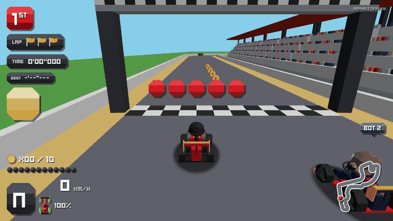

# Formula None

[](LICENSE)

A browser kart racer for up to eight friends: one link, a four-letter room
code, no install, no account. Rust simulation shared between the browser and
the server; Three.js for the picture.



Play it at <https://formulanone.sushimafia.com>: Solo race against seven
bots, or Create room and send the code to friends.

## How it's built

- **One sim, two hosts.** The rules of the game live in one Rust crate,
  `crates/sim`, with a deterministic `step(state, inputs, dt)`. The server
  runs it natively as the authority; the browser runs the same code as
  WebAssembly to predict its own kart, then reconciles with the server's
  snapshots. CI replays recorded races natively and in wasm and fails if
  the two disagree by a single bit.
- **A decision per file.** The PRD is issue 1, and each decision in it is a
  record in [`docs/adr`](docs/adr): what was chosen, what it rejected and
  what it costs. A changed decision gets a new record, never an edit.
- **A style guide that is checked.**
  [`docs/style-guide.html`](docs/style-guide.html) shows every graphic the
  game draws, with the palette, the type and the rules for the next one;
  `tools/repo-checks` holds its palette and liveries to the code.
  [`docs/GLOSSARY.md`](docs/GLOSSARY.md) fixes the words.
- **Built with an agent.** The project is built with Claude Code, one
  issue at a time: test first, a review pass, `pnpm check`, then a pull
  request the author reviews and merges. [`CLAUDE.md`](CLAUDE.md) is the
  brief it works from, and the quickest map of the repo for a person too.

## Getting started

Requirements: Rust stable (via rustup; `rust-toolchain.toml` adds clippy,
rustfmt and the wasm target), `cargo-nextest`, `wasm-pack`, Node 22 and
pnpm 11.

```sh
cargo install cargo-nextest wasm-pack --locked
pnpm install
pnpm build:bridge
```

`pnpm build:bridge` compiles the bridge crate to WebAssembly into
`apps/web/src/generated/bridge` (ignored by git). The web app, its typecheck
and its tests need it; rerun it after changing `crates/sim` or
`crates/bridge`.

| Side | Build                    | Lint                                        | Test               |
| ---- | ------------------------ | ------------------------------------------- | ------------------ |
| Rust | `cargo build --workspace` | `cargo clippy --all-targets -- -D warnings` | `cargo nextest run` |
| Web  | `pnpm build`             | `pnpm lint`                                 | `pnpm test`        |

`pnpm test:e2e` runs the Playwright smoke test against the Vite dev server
(run `pnpm --filter web exec playwright install chromium` once).

## Running locally

Two terminals from the repo root:

```sh
cargo run -p server          # HTTP and the WebSocket fallback on 0.0.0.0:8080
pnpm --filter web dev        # Vite on http://localhost:5173, proxying /api to 8080
```

Open `http://localhost:5173`. WebTransport is off without `TLS_CERT` and
`TLS_KEY`, so the client uses the WebSocket; `deploy/README.md` has the full
stack with Caddy, Prometheus and Grafana. The server's metrics are at
`http://127.0.0.1:8080/metrics` once a room has a player in it (ADR 0018).

## Hosting your own

`infra/` describes the author's own deployment on AWS, not a template; to
host the game yourself, use the Compose stack under `deploy/`, which runs
the server behind Caddy. [`deploy/README.md`](deploy/README.md) builds the
image and runs the stack on `https://localhost`. On a server of your own,
set `SITE_ADDRESS` to your domain and drop the CloudWatch logging the base
`compose.yaml` sends to the author's AWS account.

## Controls

Keyboard only. Arrows and WASD do the same thing.

| Action      | Keys                 | Notes                                                                            |
| ----------- | -------------------- | -------------------------------------------------------------------------------- |
| Steer       | Left/Right, A/D      |                                                                                  |
| Throttle    | Up, W                |                                                                                  |
| Brake       | Down, S, Q           | Reverses from a standstill. Q leaves W free to stay held through a brake drift.  |
| Hop         | Space                | Land while steering to start a drift; keep it held, let go for the mini-turbo.   |
| Item        | Shift                | Fires the held item. Keep it held to trail a hazard behind you until released.   |
| Look behind | E                    | While held.                                                                      |

Rocket start: hold the throttle from the first half of the 2 through GO for
the full boost, from the second half for a weaker one; hold it from before
the 2 and the kart stalls. The beeps count 3, 2, 1 and GO.

## Reading order

1. `CLAUDE.md` for the layout, the dependency rule and the commands.
2. `docs/GLOSSARY.md` for the vocabulary.
3. `docs/adr/` for the decisions, numbered in the PRD's order.

## Licence

The code is [MIT](LICENSE). The art and sound are CC0 1.0, made in this repo
apart from one Kenney font; [`assets/LICENSES.md`](assets/LICENSES.md)
records where each came from (ADR 0066). Contributions follow
[`CONTRIBUTING.md`](CONTRIBUTING.md).

Formula None is a parody and is not affiliated with Formula One or any
circuit.
